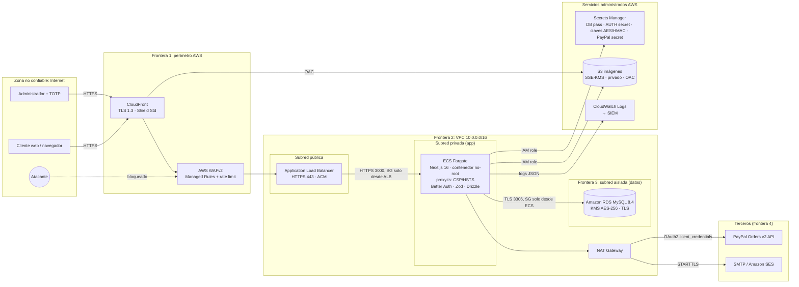

# Análisis de factibilidad y diseño de la migración segura

**Sistema:** Furniture Investment, sistema de ventas en línea
**Curso:** Seguridad en Aplicaciones, Maestría en Seguridad Informática (UMG)
**Documento base:** *Proyecto Seguridad Aplicaciones2026.pdf*
**Fecha:** 16 de noviembre de 2026

---

## 1. Resumen ejecutivo

**La migración es posible.** El sistema actual es una aplicación PHP de comercio electrónico de tamaño acotado: 8 tablas, unas 30 páginas funcionales y un único proveedor de pago (PayPal). Toda su lógica de negocio se puede reproducir en una plataforma moderna sin depender de componentes propietarios.

**Escenario elegido: Opción B del PDF (E-Commerce Web Enterprise Cloud-Native).** El enunciado menciona WooCommerce o Magento como ejemplos, pero el criterio que se evalúa es una plataforma de comercio electrónico web, desplegada en contenedores, con base de datos administrada, WAF, *hardening* e IaC. Migrar la aplicación propia del estudiante tiene dos ventajas sobre instalar un CMS genérico:

1. **Hay línea base real.** El sistema PHP heredado tiene vulnerabilidades verificables en el código fuente (sección 3). Ese sistema se usa como estado **pre-controles** en la matriz de calor, y el sistema migrado como estado **post-controles**. Así el análisis antes/después que pide la sección 4.4 del informe se apoya en evidencia y no en supuestos.
2. **Hay control total del código.** Las pruebas de caja blanca, SAST y SCA (Fases 3 y 4) se hacen sobre código propio. En un CMS de terceros la mayor parte del análisis sería sobre complementos que el estudiante no escribió.

**Plataforma destino:** Next.js 16 (App Router, TypeScript) con Better Auth (2FA TOTP y roles), Drizzle ORM sobre MySQL 8.4 (Amazon RDS cifrado con KMS en la nube), validación con Zod, pago PayPal Orders v2 verificado en servidor, contenedor Docker sin privilegios y WAF (ModSecurity + OWASP CRS en laboratorio, AWS WAFv2 en la nube). La infraestructura se define en Terraform y la integración continua corre SAST, SCA, escaneo de contenedores, análisis de IaC y DAST.

**Resultado del análisis de skills:** de las ~250 carpetas en `.claude/skills`, unas 35 sirven al proyecto. La mayoría está en formato de *plugin* y **Claude Code no las carga automáticamente** (sección 4.1).

---

## 2. Inventario del sistema heredado

### 2.1 Ubicación y tecnologías

| Elemento | Detalle |
|---|---|
| Ruta | `C:\xampp\htdocs\Desarrollo Web\Sistemas de ventas en linea` |
| Lenguaje | PHP procedural, sin framework, sin Composer |
| Acceso a datos | Mezcla de **PDO** (`config/database.php`) y **mysqli** (`admin/*/Conexion.php`) |
| Base de datos | MariaDB de XAMPP, esquema `fornitureinvestment`, usuario `root` sin contraseña |
| Front-end | Bootstrap 5 (plantilla *Furni* de Untree.co), Font Awesome por CDN, tiny-slider |
| Correo | PHPMailer 6.8.1 copiado manualmente en `phpmailer/` |
| Pagos | PayPal JavaScript SDK; la orden se crea y se captura en el navegador |
| Panel de administración | Plantilla *SB Admin* en `admin/` |
| Servidor | Apache de XAMPP sobre HTTP (`SITE_URL = http://localhost/...`) |

### 2.2 Módulos funcionales

| Módulo | Archivos principales | Descripción |
|---|---|---|
| Catálogo / tienda | `index.php`, `tienda.php`, `detalles.php` | Listado de productos activos y detalle con galería de imágenes |
| Carrito | `checkout.php`, `clases/carrito.php`, `clases/actualizar_carrito.php` | Carrito guardado en `$_SESSION`, con token HMAC-SHA1 por producto |
| Pago | `pago.php`, `clases/capture.php`, `completado.php` | Botón PayPal; el cliente envía al servidor el JSON de la captura |
| Registro y activación | `registro.php`, `activa_cliente.php`, `clases/clienteAjax.php` | Alta de cliente y usuario, activación por enlace enviado al correo |
| Recuperación de contraseña | `recupera.php`, `reset_password.php` | Token enviado por correo |
| Historial de compras | `compras.php`, `compra_detalle.php` | Compras del cliente y su detalle |
| Admin: autenticación | `admin/index.php`, `admin/clases/adminFunciones.php` | Login del administrador |
| Admin: productos | `admin/productos/*` | Alta, edición, baja y carga de imágenes |
| Admin: categorías | `admin/categorias/*` (más `viejo/`) | CRUD de categorías |
| Admin: configuración | `admin/configuracion/*` | SMTP, moneda, *client-id* de PayPal |

### 2.3 Esquema de base de datos (obtenido con `mysqldump --no-data`)

| Tabla | Campos relevantes | Observación de seguridad |
|---|---|---|
| `admin` | usuario, password (hash), email, token_password, activo | Sin MFA ni bloqueo por intentos |
| `usuarios` | usuario (UNIQUE), password (hash), activacion, token, token_password, password_request, id_cliente | Tokens de 32 hex sin fecha de expiración |
| `clientes` | nombres, apellidos, email, telefono, **dpi**, estatus | DPI (dato personal sensible) en texto claro |
| `productos` | id (manual), nombre, descripcion, precio, descuento, stock, detalles, id_categoria, activo | `id` lo ingresa el usuario; sin FK |
| `categorias` | id, nombre, activo | — |
| `compra` | id_transaccion, fecha, status, email, **id_cliente varchar(20)**, total | Tipo inconsistente con `clientes.id` (int); sin FK |
| `detalle_compra` | id_compra, id_producto, nombre, precio, cantidad | Sin FK |
| `configuracion` | nombre, valor (tinytext) | Contraseña SMTP cifrada con clave fija del código |

No hay claves foráneas en todo el esquema. La integridad referencial depende solo del código.

---

## 3. Hallazgos de seguridad del sistema heredado

Cada hallazgo se verificó leyendo el código fuente. Rutas relativas a la raíz del proyecto heredado. Clasificación por OWASP Top 10:2025, CWE y las 7 capas de seguridad del PDF (1 Datos, 2a Código, 2b Aplicación, 2c Implementación, 2d Perímetro de aplicación, 3 Host, 4 Red interna, 5 Perímetro, 6 Física, 7 Políticas).

### 3.1 Tabla de hallazgos

| ID | Hallazgo | Evidencia | OWASP 2025 | CWE | Severidad | Capa |
|---|---|---|---|---|---|---|
| H-01 | **Inyección SQL** en alta y edición de productos: los parámetros GET se concatenan directamente en `INSERT` y `UPDATE` | `admin/productos/procesar.php:7-14`, `:24`, `:56` | A05 Injection | CWE-89 | Crítica | 2a |
| H-02 | **Inyección SQL** en alta y edición de categorías | `admin/categorias/procesar.php:11`, `:16` | A05 Injection | CWE-89 | Crítica | 2a |
| H-03 | **Inyección SQL y borrado sin autenticación**: `borrar.php` no revisa la sesión y concatena `id` en `DELETE` | `admin/productos/borrar.php:3-5`, `admin/categorias/borrar.php:3-5` | A01 Broken Access Control / A05 | CWE-89, CWE-306 | Crítica | 2a, 2b |
| H-04 | **CRUD de administración sin control de acceso**: `procesar.php` (productos y categorías) no valida `$_SESSION['user_type']`, así que cualquier visitante puede insertar o modificar | `admin/productos/procesar.php:1-22`, `admin/categorias/procesar.php:1-9` | A01 | CWE-862 | Crítica | 2b, 2d |
| H-05 | **Cambio de configuración sin autenticación**: `guarda.php` actualiza SMTP y *client-id* de PayPal sin verificar la sesión (`admin/header.php` tampoco la verifica). Un atacante puede desviar pagos a su cuenta PayPal | `admin/configuracion/guarda.php:2-26` | A01 | CWE-306 | Crítica | 2b |
| H-06 | **Manipulación del monto pagado**: el monto de la orden se fija en el navegador y `capture.php` guarda `status` y `amount` del JSON enviado por el cliente sin consultar a PayPal. Se puede registrar como `COMPLETED` una compra no pagada o pagada por un monto menor | `pago.php:332-340`, `pago.php:346-360`, `clases/capture.php:19`, `:26`, `:30` | A06 Insecure Design | CWE-602, CWE-345 | Crítica | 2b |
| H-07 | **Activación de cualquier cuenta con comodín**: `validaToken` compara el token con `LIKE ?`; enviar `token=%` activa cualquier `id` sin acceso al correo | `clases/clienteFunciones.php:81`, `activa_cliente.php` | A07 Authentication Failures | CWE-287, CWE-155 | Alta | 2b |
| H-08 | **Restablecimiento de contraseña con comodín**: `verificaTokenRequest` usa `token_password LIKE ?`. Si un usuario tiene una solicitud pendiente (`password_request = 1`), `token=%` permite fijarle una contraseña nueva: **toma de cuenta** | `clases/clienteFunciones.php:145`, `reset_password.php` | A07 | CWE-640, CWE-155 | Alta | 2b |
| H-09 | Búsqueda de usuario con `LIKE` en el login (`usuario LIKE ?`): los comodines `%` y `_` resuelven a otra cuenta. Ayuda a enumerar y genera comportamiento ambiguo | `clases/clienteFunciones.php:102`, `:125`; `admin/clases/adminFunciones.php` (login) | A07 | CWE-155 | Media | 2a |
| H-10 | **Tokens predecibles y sin vencimiento**: `md5(uniqid(mt_rand()))` no es un generador criptográfico; los tokens de activación y restablecimiento no expiran | `clases/clienteFunciones.php:28` | A04 Cryptographic Failures | CWE-338, CWE-640 | Alta | 2a |
| H-11 | **IDOR en el detalle de compra**: la consulta filtra solo por `id_transaccion`, no por el cliente de la sesión. El token "anti-IDOR" es el mismo para toda la sesión y se obtiene con solo abrir `compras.php` | `compra_detalle.php:7-11`, `:19`; `compras.php:10-11` | A01 | CWE-639 | Alta | 2b |
| H-12 | **XSS reflejado en el panel**: los parámetros GET se imprimen dentro de atributos `value='...'` sin codificar | `admin/productos/guardar.php:38`, `:42`, `:47`, `:62-75`, `:92`; `admin/categorias/guardar.php:33`, `:39` | A05 Injection | CWE-79 | Alta | 2a |
| H-13 | **XSS almacenado**: nombre, descripción y detalles del producto se imprimen sin `htmlspecialchars`. Combinado con H-04, un visitante anónimo puede inyectar scripts que verá cualquier cliente | `detalles.php:115`, `:169`, `:185`, `:189`; `tienda.php:102`; `checkout.php:126`; `compra_detalle.php:123` | A05 | CWE-79 | Alta | 2a |
| H-14 | XSS reflejado en el registro: el nombre de usuario y el correo se interpolan en los mensajes de error, que `mostrarMensaje` imprime sin codificar | `registro.php:35`, `:39` | A05 | CWE-79 | Media | 2a |
| H-15 | **Interpolación en SQL** de la cantidad del carrito (`$cantidad AS cantidad`) dentro de sentencias preparadas. Hoy `carrito.php` valida con `is_numeric`, pero el patrón es inseguro y frágil: depende de que nadie más escriba esa clave de sesión | `checkout.php:18`, `pago.php:17`, `clases/capture.php:40` | A05 | CWE-89 | Media | 2a |
| H-16 | **CSRF**: ninguna operación que cambia estado usa token anti-CSRF. El CRUD de administración usa **GET** (`method='GET'`), así que basta un `` para ejecutarlo | `admin/productos/guardar.php:32`, `admin/categorias/guardar.php:25`; todo POST sin token | A01 | CWE-352 | Alta | 2b |
| H-17 | **Secretos en el código y reutilizados**: la misma cadena `Tr1f0rc3&` es la clave HMAC del carrito y la clave de cifrado | `config/config.php:23`, `admin/clases/cifrado.php:3` | A04 / A02 Security Misconfiguration | CWE-798, CWE-321 | Alta | 1, 7 |
| H-18 | **Cifrado débil**: AES-128-CBC con clave de 9 caracteres (OpenSSL la completa con ceros) y sin MAC, por lo que el texto cifrado se puede alterar (*malleability*) | `admin/clases/cifrado.php:4`, `:6-19` | A04 | CWE-326, CWE-353 | Media | 1 |
| H-19 | **Base de datos con `root` sin contraseña** y credenciales repetidas en tres archivos | `config/database.php:7-8`, `admin/config/database.php`, `admin/categorias/config_db.php:3` | A02 | CWE-250, CWE-521 | Alta | 3, 7 |
| H-20 | **Errores detallados**: se imprime el mensaje de `PDOException` y de `mysqli` (host, usuario, esquema) | `config/database.php:25`, `admin/categorias/Conexion.php:20`, `Conexion.php` (`InsertarDatos`) | A10 Mishandling of Exceptional Conditions | CWE-209 | Media | 2a |
| H-21 | **Carga de archivos insegura**: la extensión se obtiene con `explode(',')` en lugar de `'.'`, no se valida el tipo MIME ni el contenido, el nombre final queda `principaljpg` y el directorio se crea con permisos `0777` | `admin/productos/procesar.php:34`, `:39`, `:42` | A01 / A06 | CWE-434, CWE-732 | Media | 2a, 3 |
| H-22 | **Sin protección contra fuerza bruta**: no hay límite de intentos, retardo, CAPTCHA ni bloqueo en el login de clientes ni de administración | `login.php`, `admin/index.php` | A07 | CWE-307 | Alta | 2b, 5 |
| H-23 | **Fijación de sesión y cookies sin endurecer**: no se llama a `session_regenerate_id()` tras el login ni se configuran `Secure`, `HttpOnly` o `SameSite`. Clientes y administradores comparten el espacio `$_SESSION['user_id']` | `config/config.php:35`, `admin/config/config.php:3`, `clases/clienteFunciones.php` (login) | A07 | CWE-384, CWE-1004 | Media | 2b |
| H-24 | **Enumeración de usuarios y correos**: endpoint AJAX público sin límite de tasa | `clases/clienteAjax.php:14-17`; `registro.php:35`, `:39` | A07 | CWE-204 | Media | 2d |
| H-25 | **DPI en texto claro** en `clientes.dpi`, sin cifrado ni enmascaramiento | `clases/clienteFunciones.php:32`; esquema `clientes` | A04 | CWE-311, CWE-359 | Alta | 1 |
| H-26 | **Sin cabeceras de seguridad** (CSP, HSTS, X-Frame-Options, X-Content-Type-Options, Referrer-Policy) | No se encontraron en ningún `.php` | A02 | CWE-693, CWE-1021 | Media | 2d, 5 |
| H-27 | **Transporte en HTTP**: las URLs base y los enlaces de activación por correo usan `http://` | `config/config.php:22`, `admin/config/config.php:4`, `registro.php:58` | A04 | CWE-319 | Alta | 1, 5 |
| H-28 | **Sin bitácora de seguridad ni auditoría**: no se registran logins, fallos ni cambios administrativos. No hay no repudio | Todo el proyecto | A09 Security Logging & Alerting Failures | CWE-778 | Media | 2b, 7 |
| H-29 | **Dependencias sin gestión** (no hay SCA posible): PHPMailer 6.8.1 copiado a mano; Bootstrap y Font Awesome `6.0.0-beta3` por CDN sin SRI | `phpmailer/src/PHPMailer.php:753`; `<link>` en todas las páginas | A03 Software Supply Chain Failures | CWE-1104, CWE-353 | Media | 2c |
| H-30 | **Código muerto expuesto**: la carpeta `admin/categorias/viejo/` sigue publicada en el servidor web, junto con `admin/index_.php` | `admin/categorias/viejo/*.php` | A02 | CWE-1164 | Baja | 2d |
| H-31 | **Administración sin MFA** ni separación de dominio o ruta | `admin/clases/adminFunciones.php` (login) | A07 | CWE-308 | Alta | 2b |
| H-32 | Mensaje distinto para usuario no activado ("EL usuario no ha sido activado"): permite confirmar que una cuenta existe | `clases/clienteFunciones.php` (función `login`) | A07 | CWE-204 | Baja | 2b |

### 3.2 Resumen cuantitativo

| Severidad | Cantidad |
|---|---|
| Crítica | 6 (H-01 a H-06) |
| Alta | 14 |
| Media | 10 |
| Baja | 2 |
| **Total** | **32** |

Las causas de fondo se repiten: no hay una capa central de acceso a datos ni de autorización, la entrada se mezcla con la salida sin codificar, y el servidor confía en datos del cliente. Por eso conviene una migración con controles por diseño y no parches aislados sobre el código PHP.

### 3.3 Cadena de ataque ilustrativa (para casos de abuso, Fase 4)

1. Un visitante anónimo llama a `admin/configuracion/guarda.php` (H-05) y cambia `cliente_paypal` por un *client-id* que controla.
2. Llama a `admin/productos/procesar.php?accion=GRABAR&nombre=<script>...</script>` (H-04 + H-13) para dejar un script almacenado en el catálogo.
3. Los clientes pagan a la cuenta del atacante y `capture.php` registra la venta como completada (H-06).

Esta cadena sirve de base para el caso de abuso CA-01 y para la prueba de caja negra con OWASP ZAP.

---

## 4. Evaluación de las skills instaladas

### 4.1 Problema detectado: las skills no se están cargando

La carpeta `E:\Documentos\Desarrollo\.claude\skills` tiene unas 250 subcarpetas. Claude Code carga una skill de proyecto solo si encuentra **`.claude/skills/<nombre>/SKILL.md`**. La mayoría de las carpetas instaladas usa el formato de *plugin*:

```
.claude/skills/nextjs/README.md
.claude/skills/nextjs/skills/nextjs/SKILL.md      <- un nivel más profundo de lo esperado
.claude/skills/security-scanning/skills/stride-analysis-patterns/SKILL.md
```

Con esa estructura Claude Code **no detecta** skills como `nextjs`, `better-auth`, `csrf-protection` o `security-scanning`. Solo cargan las que tienen `SKILL.md` en el primer nivel (por ejemplo `owasp-security`).

**Corrección (cualquiera de las dos):**

- **Aplanar.** Mover cada carpeta interna al primer nivel. Por ejemplo, en PowerShell:
  ```powershell
  $base = "E:\Documentos\Desarrollo\.claude\skills"
  Get-ChildItem $base -Directory | ForEach-Object {
    Get-ChildItem (Join-Path $_.FullName "skills") -Directory -ErrorAction SilentlyContinue |
      Where-Object { Test-Path (Join-Path $_.FullName "SKILL.md") } |
      ForEach-Object {
        $dest = Join-Path $base $_.Name
        if (-not (Test-Path (Join-Path $dest "SKILL.md"))) { Copy-Item $_.FullName $dest -Recurse }
      }
  }
  ```
  Revise los nombres repetidos antes de ejecutarlo, porque una carpeta padre y su skill interna pueden llamarse igual (`nextjs/skills/nextjs`). En ese caso copie el contenido interno sobre la carpeta padre.
- **Instalar como plugin.** Las carpetas con `agents/`, `commands/` y `skills/` (por ejemplo `security-scanning`, `cicd-automation`, `framework-migration`) siguen la estructura de un plugin de Claude Code y pueden registrarse con `/plugin`.

También conviene **eliminar las skills que no se usarán** (sección 4.3). Cada skill cargada agrega su descripción al contexto de todas las sesiones.

> **Estado (16/11/2026):** la estructura ya se corrigió. `.claude/skills/` contiene 68 skills planas (las útiles para este proyecto). Las 249 carpetas restantes (plugins, agentes y comandos) están en `.claude/skills-archivo/`, que Claude Code no carga. Hay un respaldo completo en `.claude/skills-respaldo-2026-11-16.tar.gz`. Para recuperar una skill archivada, copie `skills-archivo/<plugin>/skills/<nombre>` a `skills/<nombre>`.
### 4.2 Skills útiles para el proyecto

Leyenda de fases: F1 Planificación y riesgos, F2 Arquitectura, F3 Desarrollo/DevSecOps, F4 Ciberdefensa, F5 Despliegue, F6 Operaciones; INF = informe.

#### Núcleo de la migración

| Skill | Útil para | Usada | Justificación |
|---|---|---|---|
| `nextjs` | F2, F3 | Sí | Cubre los cambios de Next.js 16: `proxy.ts` en lugar de `middleware.ts`, `params` asíncronos, Server Actions. Se usó para el diseño de la CSP con nonce |
| `better-auth` | F3 | Sí | Autenticación con verificación de correo, restablecimiento con tokens que expiran, límite de tasa, 2FA TOTP y roles (plugin `admin`). Sustituye el login propio (H-07 a H-10, H-22, H-23, H-31) |
| `drizzle-orm-d1` | F3 | Parcial | Está orientada a Cloudflare D1. Se aplican sus patrones de esquema tipado y migraciones con `drizzle-kit`, pero con el driver `mysql2` |
| `zod` | F3 | Sí | Validación de toda entrada en el servidor (lista blanca de tipos y rangos) |
| `react-hook-form-zod` | F3 | Opcional | Validación en el cliente con el mismo esquema. Solo mejora la experiencia de uso; el control real queda en el servidor |
| `tailwind-v4-shadcn` | F3 | Parcial | Tailwind 4 para la interfaz. shadcn/ui no es necesario |

#### Seguridad de aplicación

| Skill | Útil para | Usada | Justificación |
|---|---|---|---|
| `owasp-security` | F1, F3, F4 | Sí | Referencia de OWASP Top 10:2025 y ASVS 5.0 para clasificar los hallazgos (sección 3) |
| `csrf-protection` | F3 | Sí | Cookies `SameSite`, verificación de `Origin` y operaciones solo por POST (H-16) |
| `xss-prevention` | F3 | Sí | Codificación de salida (React escapa por defecto) y CSP estricta (H-12 a H-14) |
| `security-headers-configuration` | F3, F5 | Sí | HSTS, CSP con nonce, `frame-ancestors`, `Permissions-Policy` (H-26) |
| `api-security-hardening` | F3, F4 | Sí | Endurecimiento de los *route handlers* (`/api/*`) |
| `backend-api-security` | F3 | Sí | Autorización por objeto en el servidor (H-11) |
| `api-rate-limiting` | F3, F6 | Sí | Límite de tasa en login, registro y recuperación (H-22, H-24) |
| `session-management` | F3 | Sí | Cookies `__Secure-`, rotación y expiración de sesión (H-23) |
| `defense-in-depth-validation` | F2, F3 | Sí | Validación en cada capa: navegador, WAF, Zod, restricciones de BD |
| `cybersecurity` | F1, F4 | Sí | Pentest con herramientas de código abierto, STRIDE y reglas Sigma para el SIEM |
| `security-scanning` → `stride-analysis-patterns` | F1 | Sí | Modelado STRIDE (sección 8) |
| `security-scanning` → `sast-configuration` | F3 | Sí | Configuración de Semgrep en el pipeline |
| `security-scanning` → `threat-mitigation-mapping` | F1, F6 | Sí | Matriz de amenaza a control (sección 6) |
| `security-scanning` → `attack-tree-construction` | F4 | Sí | Árbol de ataque de la cadena de la sección 3.3 |
| `security-scanning` → `security-requirement-extraction` | F1 | Sí | Requisitos de seguridad derivados de las amenazas |
| `vulnerability-scanning` | F3, F5 | Sí | `npm audit`, Trivy y compuertas de severidad en CI |
| `security-compliance` | F1, INF | Sí | Correspondencia con controles de ISO/IEC 27001:2022, Anexo A |
| `signed-audit-trails` | F3, F6 | Sí | Bitácora con cadena de hashes para no repudio (H-28) |
| `logging-best-practices` | F6 | Sí | Logs estructurados en JSON sin datos personales, listos para el SIEM |

#### DevSecOps y nube

| Skill | Útil para | Usada | Justificación |
|---|---|---|---|
| `cicd-automation` → `github-actions-templates` | F3, F5 | Sí | Pipeline con Semgrep, npm audit, Gitleaks, Trivy, Checkov y ZAP |
| `cicd-automation` → `secrets-management` | F2, F5 | Sí | Secretos en AWS Secrets Manager y variables de entorno, nunca en el código (H-17, H-19) |
| `cicd-automation` → `deployment-pipeline-design` | F5 | Parcial | Etapas y compuertas de aprobación |
| `cloud-infrastructure` | F2, F5 | Parcial | VPC, subredes privadas, mTLS y costos. Útil para la arquitectura en AWS |
| `deployment-strategies` | F5 | Opcional | Despliegue *blue/green* en ECS |
| `health-check-endpoints` | F5, F6 | Sí | `/api/health` para el ALB, sin revelar información interna |

#### Pagos

| Skill | Útil para | Usada | Justificación |
|---|---|---|---|
| `payment-gateway-integration` | F3 | Sí | Integración de PayPal en el servidor: crear y capturar la orden y verificar el monto (H-06) |
| `payment-processing` | F3 | Parcial | Patrones de PCI DSS: no almacenar datos de tarjeta |
| `idempotency-handling` | F3 | Sí | Evitar doble registro de una captura |

#### Pruebas

| Skill | Útil para | Usada | Justificación |
|---|---|---|---|
| `vitest-testing` | F3 | Sí | Pruebas unitarias de cifrado, validación y cálculo de totales |
| `playwright` / `webapp-testing` | F4 | Opcional | Pruebas E2E y automatización de casos de abuso (fuerza bruta, IDOR) |

#### Documentación e informe

| Skill | Útil para | Usada | Justificación |
|---|---|---|---|
| `c4-architecture` | F2, INF 4.1 | Recomendada | Diagramas de contexto y contenedores |
| `technical-specification` | INF | Recomendada | Estructura de la especificación técnica |
| `docx` / `pdf` | INF | Recomendada | Producir el informe final con formato UMG (Arial 12, interlineado 1.5) |
| `humanize-writing` / `avoid-ai-writing` | INF | Opcional | Revisar el estilo de redacción del informe |

### 4.3 Skills que no aportan a este proyecto

| Grupo | Ejemplos | Motivo |
|---|---|---|
| Cloudflare | `cloudflare-workers`, `cloudflare-d1`, `cloudflare-r2`, `cloudflare-kv`, etc. | La arquitectura objetivo es AWS. **Excepción:** `cloudflare-turnstile` puede usarse como anti-bot opcional en registro y login |
| Otros frameworks front-end | `nuxt-*`, `shadcn-vue`, `pinia-*`, `inspira-ui`, `maz-ui`, `tanstack-start` | Se eligió Next.js/React |
| WordPress / WooCommerce | `woocommerce-*`, `wordpress-plugin-core` | Solo aplican si se cambia a WooCommerce |
| Ajenas al dominio | `game-development`, `ml-*`, `llm-finetuning`, `quantitative-trading`, `blockchain-web3`, `arm-cortex-microcontrollers`, `dgx-spark-ops`, `threejs`, `julia-development` | No relacionadas |
| Marketing y SEO | `seo-*`, `content-marketing`, `social-publishing`, `hermes-tweet` | No relacionadas |
| Móvil | `react-native-skills`, `app-store-deployment`, `mobile-*` | Solo aplican a la Opción A (banca móvil) |

---

## 5. Arquitectura objetivo

### 5.1 Stack tecnológico

| Capa | Tecnología | Control de seguridad principal |
|---|---|---|
| Presentación y BFF | **Next.js 16** (App Router, Server Components, Server Actions), **TypeScript** estricto | Escape automático de salida en React; la lógica sensible se ejecuta solo en el servidor (`server-only`) |
| Cabeceras / perímetro de la aplicación | `src/proxy.ts` | **CSP con nonce** por solicitud, HSTS, `frame-ancestors 'none'`, `nosniff`, `Referrer-Policy`, `Permissions-Policy` |
| Identidad | **Better Auth 1.7** | Contraseñas con hash scrypt, verificación de correo obligatoria, tokens aleatorios con vencimiento, límite de tasa, **2FA TOTP** para el administrador, roles `admin`/`user`, cookies `HttpOnly`/`Secure`/`SameSite=Lax` |
| Validación | **Zod 4** | Esquemas de lista blanca para cada formulario y endpoint |
| Acceso a datos | **Drizzle ORM** + `mysql2` | Solo consultas parametrizadas, llaves foráneas en el esquema, `multipleStatements: false`, usuario de BD con privilegios mínimos |
| Base de datos | **MySQL 8.4** (local: MariaDB de XAMPP; nube: **Amazon RDS** Multi-AZ cifrado con **KMS**, TLS obligatorio) | Cifrado en reposo y en tránsito, respaldos cifrados |
| Datos sensibles | `src/lib/crypto.ts` | **AES-256-GCM** para el DPI (cifrado autenticado), **HMAC-SHA256** para búsqueda sin descifrar, claves en Secrets Manager |
| Pagos | **PayPal Orders v2 REST** (`src/lib/paypal.ts`) | La orden se crea **en el servidor** con el total recalculado desde la BD; la captura se hace en el servidor y se verifica `status`, monto, moneda y `custom_id` |
| Auditoría | `src/lib/audit.ts` | Bitácora en BD con **cadena HMAC-SHA256** (cada registro incluye el hash del anterior; `npm run auditoria:verificar` y la vista `/admin/auditoria` detectan alteraciones) para detectar alteraciones |
| Contenedor | Docker multi-etapa, `node:22-alpine`, usuario sin privilegios, sistema de archivos de solo lectura, `HEALTHCHECK` | Superficie mínima, escaneo con Trivy |
| WAF | **ModSecurity + OWASP CRS** (laboratorio con Docker Compose) / **AWS WAFv2** con reglas administradas (nube) | Bloqueo de patrones del OWASP Top 10, límite de tasa por IP |
| Red y cómputo en la nube | CloudFront → ALB (**TLS 1.3**, ACM) → **ECS Fargate** en subredes privadas → RDS en subredes aisladas | Segmentación y *security groups* con referencias entre grupos |
| Secretos | **AWS Secrets Manager** + roles IAM de tarea con mínimo privilegio | Nada sensible en imágenes ni repositorio |
| Monitoreo | CloudWatch Logs → OpenSearch / SIEM (Wazuh opcional), alarmas | Detección de fuerza bruta y picos 4xx/5xx |
| IaC | **Terraform** (`infra/terraform`) | Revisado con Checkov y tfsec |
| CI/CD | **GitHub Actions** (`.github/workflows/devsecops.yml`) | Semgrep (SAST), npm audit / OSV (SCA), Gitleaks (secretos), Trivy (imagen), Checkov (IaC), OWASP ZAP baseline (DAST) |

### 5.2 Diagrama de flujo de datos y fronteras de confianza



En el laboratorio local (Docker Compose), CloudFront y WAFv2 se reemplazan por **Nginx + ModSecurity CRS**, y RDS por un contenedor **MySQL 8.4** en una red interna sin puertos publicados.

### 5.3 Principio de mínimo privilegio

| Identidad | Permisos |
|---|---|
| Usuario de BD de la aplicación (`ventas_app`) | `SELECT, INSERT, UPDATE, DELETE` sobre el esquema de la aplicación. Sin `DROP`, `ALTER`, `FILE` ni `GRANT` |
| Usuario de migraciones (`ventas_migrator`) | DDL solo durante el despliegue, desde el pipeline |
| Rol IAM de ejecución de la tarea ECS | `secretsmanager:GetSecretValue` solo sobre los ARN de la aplicación, `kms:Decrypt` sobre su clave |
| Rol IAM de la tarea | `s3:GetObject/PutObject` sobre `bucket/productos/*` |
| Rol de administrador en la aplicación | Requiere 2FA TOTP activo; es el único que accede a `/admin/*` y a las Server Actions de catálogo y configuración |
| Cliente | Solo ve sus pedidos (filtro `user_id = sesión` en cada consulta) |

---

## 6. Correspondencia hallazgo → control en el sistema nuevo

Tipo de control según la metodología de *threat-mitigation-mapping*: **P** = preventivo (impide el ataque), **D** = detectivo (lo identifica mientras ocurre o después), **C** = correctivo (recupera o compensa el daño). Cada hallazgo debe quedar cubierto por al menos un control preventivo y, en los críticos, también por uno detectivo o correctivo (defensa en profundidad).

| Hallazgo | Control implementado | Tipo | Ubicación en el código |
|---|---|---|---|
| H-01, H-02, H-03, H-15 | Consultas parametrizadas con Drizzle; no se concatena SQL; IDs validados como enteros con Zod; escape de comodines `LIKE`; `multipleStatements: false`. Detección: reglas CRS de SQLi en el WAF y reglas Semgrep en CI | P, D | `src/db/index.ts`, `src/lib/validation.ts`, `src/lib/catalogo.ts`, `src/app/admin/acciones.ts`, `infra/waf/`, `security/semgrep/reglas-ventas.yml` |
| H-03, H-04, H-05, H-31 | `requerirAdmin()` / `asegurarAdmin()` en el servidor dentro de **cada** página y Server Action de `/admin`; rol `admin` + 2FA TOTP obligatorio; las acciones críticas (cambio de rol, configuración) exigen sesión reciente (< 10 min). Los intentos denegados se auditan como `acceso.admin_denegado` | P, D | `src/lib/session.ts`, `src/lib/auth.ts`, `src/app/admin/layout.tsx`, `src/app/admin/acciones.ts` |
| H-06 | Orden PayPal creada en el servidor con el total recalculado desde la BD; captura en el servidor con verificación de `status = COMPLETED`, monto, moneda y `custom_id`; `PayPal-Request-Id` idempotente y `referencia_pago` UNIQUE. **Confirmación a prueba de concurrencia**: `UPDATE` condicional `pendiente → procesando` que exige `affectedRows = 1` antes de descontar stock. **Reembolso automático** (`reembolsarCaptura`, estado `reembolsada`) si falta stock o el monto no coincide. **Conciliación** de órdenes pendientes (`npm run pagos:conciliar`). Auditoría `pago.manipulacion_detectada` | P, D, C | `src/lib/paypal.ts`, `src/lib/ordenes.ts`, `src/app/(cliente)/checkout/retorno/route.ts`, `scripts/conciliar-pagos.ts` |
| H-07, H-08, H-10 | Tokens de verificación y restablecimiento generados por Better Auth (aleatorios, de un solo uso, con vencimiento de 24 h y 30 min); comparación exacta; revocación de sesiones al restablecer | P | `src/lib/auth.ts` |
| H-09, H-24, H-32 | Login por correo con comparación exacta; mensajes genéricos en login, registro y recuperación; sin endpoint de "¿existe usuario?" | P | `src/lib/auth.ts`, `src/app/(auth)/acciones.ts` |
| H-11 | Toda consulta de pedidos filtra por el `userId` de la sesión; IDs UUID no secuenciales; respuesta 404 (no 403) y auditoría `acceso.pedido_ajeno` | P, D | `src/app/(cliente)/pedido/[id]/page.tsx`, `src/lib/ordenes.ts` |
| H-12, H-13, H-14 | React escapa la salida; `dangerouslySetInnerHTML` prohibido (regla Semgrep); CSP con nonce y `strict-dynamic`; reglas XSS del CRS | P, D | `src/proxy.ts`, `security/semgrep/reglas-ventas.yml`, `infra/waf/` |
| H-16 | Server Actions solo por POST con verificación de `Origin` integrada en Next.js; cookies `SameSite=Lax`; `trustedOrigins` en Better Auth; `form-action` en la CSP | P | `src/proxy.ts`, `src/lib/auth.ts` |
| H-17, H-19 | Secretos solo en variables de entorno validadas con Zod al arrancar; en producción se exige `TRUST_PROXY=true` y `PAYPAL_API_BASE` explícito; Secrets Manager con KMS en la nube; usuario de BD con privilegios mínimos; Gitleaks en CI | P, D | `src/lib/env.ts`, `.env.example`, `infra/terraform/aws/secrets.tf`, `infra/db/init/01-usuarios.sh`, `.github/workflows/devsecops.yml` |
| H-18, H-25 | AES-256-GCM con clave de 32 bytes e IV aleatorio por registro; HMAC-SHA256 para unicidad y búsqueda del DPI; la interfaz muestra el DPI enmascarado | P | `src/lib/crypto.ts` |
| H-20 | Páginas de error genéricas (`error.tsx` y `global-error.tsx`) con identificador de referencia; los detalles solo van al log del servidor; los fallos inesperados se registran en lugar de ocultarse | P, D | `src/app/error.tsx`, `src/app/global-error.tsx`, `src/lib/logger.ts` |
| H-21 | Imágenes: tamaño máximo, verificación por *magic bytes* (JPEG/PNG/WebP), nombre UUID generado por el servidor, almacenamiento fuera del webroot o en S3 privado; servidas con `sandbox` y `nosniff`; rechazo auditado (`upload.rejected`) | P, D | `src/lib/uploads.ts`, `src/app/api/imagenes/[archivo]/route.ts` |
| H-22 | Límite de tasa persistente en BD por IP **y por cuenta** en login, 2FA, registro y recuperación; límite de Better Auth en `/api/auth/*`; bloqueo del 2FA tras intentos fallidos; `limit_req` en Nginx para `POST /login`, `/registro`, `/recuperar`, `/login/2fa` y `/api/auth/*`; regla *rate-based* en AWS WAF; verificación de contraseñas filtradas (plugin `haveIBeenPwned`, k-anonymity) | P, D | `src/lib/rate-limit.ts`, `src/app/(auth)/acciones.ts`, `src/lib/auth.ts`, `infra/waf/`, `infra/terraform/aws/waf.tf` |
| H-23 | Sesión gestionada por Better Auth: token nuevo en cada login, cookie `__Secure-` `HttpOnly` `SameSite=Lax`, expiración de 1 día, `freshAge` de 10 min, revocación al cambiar contraseña o rol | P | `src/lib/auth.ts`, `src/app/admin/acciones.ts` |
| H-26 | Cabeceras de seguridad en `proxy.ts` y `next.config.ts` (`poweredByHeader: false`); verificadas por ZAP baseline | P, D | `src/proxy.ts`, `next.config.ts`, `security/zap/rules.tsv` |
| H-27 | HTTPS de extremo a extremo: TLS 1.3 en ALB, HSTS con *preload*, TLS verificado hacia la BD gestionada (`DATABASE_CA_CERT`) | P | `infra/terraform/aws/alb.tf`, `next.config.ts`, `src/db/index.ts` |
| H-28 | Bitácora de auditoría encadenada con HMAC-SHA256; verificación de integridad (`npm run auditoria:verificar`, vista `/admin/auditoria`); eventos JSON al SIEM con alarmas de CloudWatch | D | `src/lib/audit.ts`, `scripts/verificar-auditoria.ts`, `infra/terraform/aws/cloudwatch.tf` |
| H-29 | Dependencias declaradas con lockfile; `npm ci --ignore-scripts`; `.npmrc` endurecido; npm audit, OSV y Trivy como *gates* en CI; Dependabot con período de espera; acciones de GitHub fijadas por SHA | P, D | `package.json`, `.npmrc`, `.github/workflows/devsecops.yml`, `.github/dependabot.yml` |
| H-30 | Imagen de producción con salida *standalone*: solo se copia el build, sin código muerto; contenedor no-root y de solo lectura | P | `Dockerfile` |
| (transversal) | **Correctivos de continuidad**: snapshots automáticos y recuperación a un punto en el tiempo (PITR) de RDS con retención de 7 días; versionado del bucket S3; runbook de respuesta a incidentes (§8.5) | C | `infra/terraform/aws/rds.tf`, `infra/terraform/aws/s3.tf` |

### 6.1 Requisitos de seguridad (RS) trazables

Derivados de las amenazas de la sección 8 según la metodología de *security-requirement-extraction*: cada requisito se vincula a una o más amenazas, es verificable y tiene un criterio de aceptación y una prueba o evidencia concreta. Tipos: **F** = funcional (qué debe hacer el sistema), **NF** = no funcional (cómo debe comportarse), **R** = restricción (limitación impuesta).

| ID | Amenaza(s) | Tipo | Requisito verificable | Criterio de aceptación | Verificación |
|---|---|---|---|---|---|
| RS-01 | T-01, T-19 | F | El sistema debe limitar los intentos fallidos de login por cuenta y por IP | Al 6.º intento fallido sobre la misma cuenta en 15 min se muestra "Demasiados intentos" y no se evalúa la contraseña | `e2e/auth.spec.ts` (rate limit); `tests/rate-limit.test.ts` |
| RS-02 | T-01, T-06 | F | Toda cuenta con rol `admin` debe tener 2FA TOTP activo para acceder a `/admin` | Un admin sin 2FA es redirigido a `/cuenta/seguridad?requiere2fa=1`; con 2FA accede al panel | `e2e/admin.spec.ts` (2FA obligatorio) |
| RS-03 | T-01 | F | La verificación del segundo factor debe limitarse por cuenta, aunque la IP no sea confiable | Al 6.º código erróneo en 5 min la cuenta queda bloqueada para 2FA | `tests/rate-limit.test.ts`; revisión de `src/app/(auth)/acciones.ts` |
| RS-04 | T-01 | NF | Las contraseñas deben tener al menos 12 caracteres y no figurar en listas de contraseñas filtradas | El registro rechaza "corta" y contraseñas presentes en HIBP | `tests/validation.test.ts`; `e2e/auth.spec.ts` (contraseña débil) |
| RS-05 | T-11 | F | La cuenta solo se activa con un token de verificación de un solo uso enviado al correo | El login antes de verificar el correo falla con mensaje genérico; después de abrir el enlace, funciona | `e2e/auth.spec.ts` (registro y verificación) |
| RS-06 | T-06, T-16 | F | Cada página y Server Action de `/admin` debe verificar en el servidor rol `admin`, 2FA activo y, en acciones críticas, sesión de menos de 10 min | Un cliente autenticado que abre `/admin` termina fuera del panel y el intento queda auditado como `acceso.admin_denegado` | `e2e/admin.spec.ts` (acceso no-admin bloqueado); bitácora |
| RS-07 | T-07 | F | Un usuario solo puede consultar sus propios pedidos | Abrir `/pedido/<uuid ajeno>` devuelve 404 y genera el evento `acceso.pedido_ajeno` | `e2e/compra.spec.ts` (IDOR) |
| RS-08 | T-02, T-12 | F | El monto a cobrar se calcula en el servidor y se verifica contra la respuesta de PayPal (monto, moneda, `custom_id`, estado) | Una captura con monto distinto marca la orden como fallida, la reembolsa y audita `pago.manipulacion_detectada` | Revisión de `src/lib/ordenes.ts`; regla Semgrep "precio desde el cliente" |
| RS-09 | T-17 | F | La confirmación de un pago debe ser atómica e idempotente | Dos confirmaciones simultáneas de la misma orden descuentan el stock una sola vez | `e2e/compra.spec.ts` (stock); revisión de `affectedRows` en `src/lib/ordenes.ts` |
| RS-10 | T-02, T-17 | F | Si un pago capturado no puede completarse (sin stock o monto inválido) se debe reembolsar automáticamente | La orden pasa a `reembolsada` y queda el evento de reembolso en la bitácora | Revisión de `reembolsarCaptura`; prueba en sandbox de PayPal |
| RS-11 | T-12 | NF | Las órdenes pendientes deben conciliarse periódicamente con PayPal | `npm run pagos:conciliar` actualiza las órdenes capturadas cuyo retorno se perdió | Ejecución del script contra sandbox |
| RS-12 | T-02 | F | El contenido del carrito en el cliente debe estar protegido contra manipulación | Una cookie de carrito con firma HMAC inválida se descarta | `e2e/compra.spec.ts` (cookie alterada) |
| RS-13 | T-09 | F | Todo contenido de usuario debe mostrarse como texto, nunca como HTML ejecutable | Un producto con `` en el nombre se muestra literal y no ejecuta script | `e2e/admin.spec.ts` (XSS almacenado); Semgrep |
| RS-14 | T-09, T-08 | NF | Todas las respuestas HTML deben incluir CSP con nonce, HSTS, `X-Frame-Options: DENY`, `nosniff` y sin `X-Powered-By` | Las cabeceras están presentes y la consola no registra violaciones de CSP | `e2e/cabeceras.spec.ts`; ZAP baseline |
| RS-15 | T-04 | R | El DPI debe almacenarse cifrado con un algoritmo autenticado (AES-256-GCM) y mostrarse enmascarado | Alterar el texto cifrado provoca error al descifrar; la vista muestra solo los últimos 4 dígitos | `tests/crypto.test.ts` |
| RS-16 | T-03, T-14 | F | Las acciones de seguridad y administración deben quedar en una bitácora a prueba de manipulación | `npm run auditoria:verificar` devuelve código 1 si se altera cualquier registro | `npm run auditoria:verificar`; prueba de manipulación documentada |
| RS-17 | T-10 | F | Solo se aceptan imágenes JPEG, PNG o WebP de hasta 2 MB, validadas por contenido | Un archivo con extensión `.jpg` pero otro contenido es rechazado y auditado | Revisión de `src/lib/uploads.ts`; prueba manual en el panel |
| RS-18 | T-15, T-18 | R | Ningún secreto debe estar en el repositorio, la imagen ni el estado de Terraform sin cifrar | Gitleaks y Trivy (secret scan) sin hallazgos; backend de estado S3 con KMS | Jobs `secrets` y `container` del pipeline; `infra/terraform/aws/providers.tf` |
| RS-19 | T-18 | R | Las dependencias y acciones de CI deben provenir de versiones fijadas y sin vulnerabilidades altas o críticas | npm audit, OSV y Trivy sin hallazgos HIGH/CRITICAL; acciones fijadas por SHA | Jobs `sca`, `container` y revisión de `devsecops.yml` |
| RS-20 | T-09, T-01 | NF | El código debe superar el análisis estático antes de integrarse | Semgrep sin hallazgos de severidad ERROR | Job `sast` (Semgrep, SARIF) |
| RS-21 | T-15, T-20 | R | La infraestructura debe cumplir las políticas de seguridad de IaC | Checkov sin fallos (los *skip* deben estar justificados) | Job `iac` (Checkov) |
| RS-22 | T-05, T-21 | NF | El balanceador solo debe enviar tráfico a instancias con base de datos disponible | `/api/health?db=1` responde 503 en menos de 3 s si la BD no responde | Revisión de `src/app/api/health/route.ts` y `alb.tf` |

---


## 7. Mapa de entregables del PDF

### 7.1 Por fase

| Fase del PDF | Entregable | Artefacto en el repositorio | Pendiente del estudiante |
|---|---|---|---|
| F1.1 Inventario de activos ISO 27001 | Tabla de activos con CIA y criticidad | Base: secciones 2 y 5 de este documento | Elaborar la tabla formal (ID, proceso, tipo, ubicación, C/I/A, propietario, custodio) |
| F1.2 STRIDE / DREAD | Modelado y puntuación | Sección 8: amenazas T-01 a T-21, STRIDE por elemento del DFD (8.3) y requisitos RS (6.1) | Validar puntajes en equipo; modelar en **OWASP Threat Dragon** y adjuntar capturas |
| F1.3 Siete capas | Hallazgos por capa | Columna "Capa" de la sección 3.1 | Redactar cada capa, incluida la 6 (certificaciones SOC 2 / ISO 27001 de AWS) y la 7 (políticas) |
| F2 Arquitectura | Diagrama y controles | Sección 5; `infra/terraform/` | Exportar el diagrama Mermaid como imagen para el informe |
| F3 SAST | Evidencia de SAST | Job `sast` (Semgrep) en el pipeline; reglas en `security/semgrep/` | Ejecutar Semgrep **sobre el código PHP heredado y sobre el nuevo** y comparar resultados |
| F3 SCA | Evidencia de SCA | Job `npm audit` / OSV; registro de esta migración (11 vulnerabilidades corregidas a 0 al instalar) | Capturas; OWASP Dependency-Check opcional sobre el PHP heredado |
| F3 Codificación segura | Ejemplos de mitigación en código | Sección 6 | Seleccionar fragmentos antes/después para el informe |
| F4 Caja negra | Reporte de pentest | Job `zap-baseline` | **Ejecutar OWASP ZAP / Burp sobre el sistema heredado y sobre el nuevo**, con capturas |
| F4 Caja gris/blanca | Revisión con código | Sección 3 (H-01 a H-32) | Comprobar en laboratorio al menos H-05, H-06, H-07 y H-11 |
| F4 Casos de abuso | Escenarios detallados | Sección 3.3 y amenazas de la sección 8 | Redactar CA-01 a CA-05 (fuerza bruta, manipulación de precio, IDOR, CSRF admin, toma de cuenta por restablecimiento) |
| F4 Perímetro | Superficie de ataque | Rutas de `src/app`, puertos del compose | Escaneo con `nmap` del laboratorio y tabla de endpoints públicos y privados |
| F5 Contenedores | Escaneo de imagen | `Dockerfile`, job `trivy` | Capturas del reporte de Trivy |
| F5 IaC | Auditoría Terraform | `infra/terraform/`, job `checkov` | Capturas de Checkov y tfsec; justificar los *skip* |
| F6 WAF / RASP / SIEM | Configuración | `infra/waf/` (ModSecurity CRS), `waf.tf`, `src/lib/audit.ts`, logs JSON | Describir la integración con Wazuh u OpenSearch; probar el bloqueo con ZAP |
| F6 Tratamiento del riesgo | Matriz de decisiones | Secciones 6 (tipo de control P/D/C), 8.2, 8.4 y runbook 8.5 | Clasificar cada riesgo (Aceptar/Eliminar/Evitar/Mitigar/Transferir) por tipo e impacto |
| F6 Matriz de calor | Gráfica pre/post | Puntajes de la sección 8 | **Elaborar la gráfica** (Excel o Python) |

### 7.2 Por sección del informe final

| Sección del informe | Fuente principal |
|---|---|
| 1–2 Carátula UMG, índices | **Manual** (formato UMG: Arial 12, interlineado 1.5, sangrías) |
| 3 Introducción | Manual, a partir de la sección 1 |
| 4.1 Descripción de la aplicación | Secciones 2 y 5 |
| 4.2 Inventario de activos | Sección 2 + tabla manual |
| 4.3 STRIDE/DREAD por 7 capas | Secciones 3, 8.1 a 8.4 |
| 4.4 Matriz de calor pre/post | Sección 8 + gráfica manual |
| 4.5 Plan de tratamiento | Secciones 6, 6.1, 8.2, 8.4 y 8.5 |
| 4.6 Ciberdefensa | Sección 3, resultados de ZAP/Burp/nmap (manual) |
| 4.7 Ciberseguridad y DevSecOps | Pipeline, Terraform, WAF, sección 6 |
| 4.8 Dictamen final | Manual, comparando el riesgo residual |
| 5 Conclusiones | Manual |
| 6 Bibliografía APA | **Manual** (OWASP Top 10:2025, ASVS 5.0, ISO/IEC 27001:2022, NIST SP 800-63B, documentación de Next.js, Better Auth y AWS) |
| 7 Anexos | Capturas, reportes de herramientas, `devsecops.yml`, Terraform |

---

## 8. Semilla de modelado STRIDE / DREAD

Escala DREAD de 1 a 10 por factor: **D**amage (daño), **R**eproducibility (reproducibilidad), **E**xploitability (explotabilidad), **A**ffected users (usuarios afectados), **D**iscoverability (descubribilidad). Promedio = suma / 5. Rango sugerido: 1–3.9 Bajo, 4–6.9 Medio, 7–10 Alto.

Para la matriz de calor (probabilidad × impacto) se puede usar **Probabilidad ≈ promedio(R, E, Di)** e **Impacto ≈ promedio(D, A)**.

Los puntajes son una propuesta inicial y deben validarse en el taller de evaluación del grupo.

### 8.1 Antes (sistema PHP heredado)

| ID | STRIDE | Amenaza | Hallazgos | D | R | E | A | Di | **Prom.** | Nivel |
|---|---|---|---|---|---|---|---|---|---|---|
| T-01 | S | Suplantación por fuerza bruta o *credential stuffing* en login de cliente y admin | H-22, H-31 | 8 | 9 | 8 | 7 | 9 | **8.2** | Alto |
| T-02 | T | Manipulación del monto o estado del pago | H-06 | 9 | 10 | 7 | 8 | 6 | **8.0** | Alto |
| T-03 | R | Cambios en catálogo o configuración sin rastro (no repudio) | H-04, H-05, H-28 | 6 | 10 | 9 | 8 | 7 | **8.0** | Alto |
| T-04 | I | Exposición del DPI y otros datos personales (volcado por SQLi o acceso a la BD) | H-01, H-19, H-25 | 9 | 8 | 7 | 10 | 7 | **8.2** | Alto |
| T-05 | D | Denegación de servicio en login y registro (sin límite de tasa) | H-22, H-24 | 5 | 9 | 8 | 9 | 8 | **7.8** | Alto |
| T-06 | E | Elevación a administrador: endpoints admin sin autenticación | H-03, H-04, H-05 | 10 | 10 | 9 | 10 | 8 | **9.4** | Alto |
| T-07 | I | IDOR en el detalle de pedidos de otros clientes | H-11 | 6 | 10 | 8 | 8 | 7 | **7.8** | Alto |
| T-08 | T | CSRF sobre el CRUD de administración (por GET) | H-16 | 8 | 9 | 8 | 8 | 7 | **8.0** | Alto |
| T-09 | T/E | XSS almacenado y reflejado (robo de sesión, *defacement*) | H-12, H-13, H-14, H-26 | 8 | 9 | 8 | 9 | 8 | **8.4** | Alto |
| T-10 | T/E | Carga de archivo malicioso / escritura arbitraria en el servidor | H-21 | 7 | 7 | 6 | 8 | 5 | **6.6** | Medio |
| T-11 | S/E | Toma de cuenta por comodín en tokens de activación y restablecimiento | H-07, H-08, H-10 | 8 | 9 | 7 | 7 | 5 | **7.2** | Alto |

### 8.2 Después (sistema migrado con controles)

Tratamiento: cuando el **daño potencial (D) sigue siendo ≥ 8**, el riesgo no se elimina aunque la probabilidad baje: se **mitiga**. Solo se usaría "Eliminar" si el activo o la funcionalidad dejaran de existir.

| ID | Control principal | Tipo | D | R | E | A | Di | **Prom.** | Nivel | Tratamiento |
|---|---|---|---|---|---|---|---|---|---|---|
| T-01 | Límite de tasa por IP y por cuenta (login y 2FA), 2FA admin, HIBP, WAF, hash scrypt; alerta SIEM por fuerza bruta | P, D | 8 | 3 | 2 | 3 | 5 | **4.2** | Medio | Mitigar |
| T-02 | Orden y captura PayPal en servidor, verificación de monto, idempotencia, reembolso automático | P, D, C | 9 | 1 | 1 | 2 | 3 | **3.2** | Bajo | Mitigar |
| T-03 | Bitácora encadenada con HMAC, `requerirAdmin`, logs al SIEM | P, D | 6 | 2 | 2 | 3 | 3 | **3.2** | Bajo | Mitigar |
| T-04 | AES-256-GCM en DPI, RDS con KMS, usuario de BD con mínimo privilegio, sin SQLi | P | 9 | 2 | 2 | 3 | 3 | **3.8** | Bajo | Mitigar |
| T-05 | Límite de tasa en app y WAF, autoescalado ECS, Shield Standard, *readiness* en el ALB | P, D | 5 | 4 | 3 | 5 | 6 | **4.6** | Medio | Mitigar / Transferir (AWS Shield) |
| T-06 | Autorización en servidor por acción, rol + 2FA, sesión reciente en acciones críticas, red privada, auditoría de accesos denegados | P, D | 10 | 1 | 1 | 2 | 2 | **3.2** | Bajo | Mitigar |
| T-07 | Filtro por `userId` de la sesión en cada consulta; 404 y auditoría | P, D | 6 | 1 | 1 | 2 | 3 | **2.6** | Bajo | Mitigar |
| T-08 | Server Actions por POST con verificación de origen, `SameSite` | P | 8 | 2 | 2 | 3 | 3 | **3.6** | Bajo | Mitigar |
| T-09 | Escape por defecto de React, CSP con nonce, regla Semgrep, CRS | P, D | 8 | 2 | 2 | 3 | 4 | **3.8** | Bajo | Mitigar |
| T-10 | *Magic bytes*, tamaño máximo, nombre generado, S3 privado | P, D | 7 | 2 | 2 | 3 | 3 | **3.4** | Bajo | Mitigar |
| T-11 | Tokens aleatorios de un solo uso con vencimiento (Better Auth) | P | 8 | 1 | 1 | 2 | 2 | **2.8** | Bajo | Mitigar |

**Riesgo residual a reportar:** T-01 y T-05 quedan en nivel medio. La autenticación y la disponibilidad siguen siendo objetivos de ataque masivo aunque haya controles. Se propone **aceptar** ese riesgo residual con monitoreo en el SIEM y alertas por umbral.

### 8.3 STRIDE por elemento del diagrama de flujo de datos

Siguiendo la metodología de *stride-analysis-patterns*, cada elemento del DFD de la sección 5.2 se evalúa contra las seis categorías. Las celdas indican la amenaza (T-xx) o "—" cuando la categoría no aplica al elemento. Las amenazas T-12 a T-21 son propias de la arquitectura nueva y se detallan en 8.4.

| Elemento del DFD | S | T | R | I | D | E |
|---|---|---|---|---|---|---|
| Cliente / navegador | T-01 (robo de credenciales), T-11 | T-02 (carrito, precio) | — | T-09 (XSS roba datos) | — | T-09 |
| CloudFront / WAF / Nginx-CRS | — | T-18 (reglas alteradas por pipeline comprometido) | — | — | T-05, T-19 | — |
| ALB | — | — | — | T-04 (TLS débil, mitigado con TLS 1.3) | T-21 (tráfico a instancias no sanas) | — |
| App Next.js en ECS | T-16 (sesión de admin robada) | T-17 (carrera en confirmación de pago) | T-03 | T-07 (IDOR), T-20 | T-05 | T-06 |
| Server Actions / `proxy.ts` | — | T-08 (CSRF) | — | — | — | T-06, T-16 |
| Better Auth (`/api/auth`) | T-01, T-11 | — | — | — (mensajes genéricos) | T-19 (bloqueo de cuentas ajenas) | — |
| RDS MySQL | — | T-02, T-03 | T-14 | T-04 | T-21 | — |
| S3 imágenes | — | T-10 | — | T-20 (exfiltración) | — | — |
| Secrets Manager / KMS / tfstate | — | — | — | T-15 (robo de secretos) | — | T-15 |
| PayPal API | T-12 (respuesta o retorno falsificado) | T-02 | — | — | T-12 (captura perdida por timeout) | — |
| SMTP / SES | T-13 (correos a nombre de la tienda) | — | — | — | T-13 (envío masivo de recuperaciones) | — |
| CloudWatch / SIEM | — | T-14 (manipulación de logs) | T-14 | — | — | — |
| Pipeline CI/CD (GitHub Actions) | — | T-18 (acción o dependencia comprometida) | — | T-15 (secretos en logs) | — | T-18 |

### 8.4 Amenazas nuevas de la arquitectura migrada (T-12 a T-21)

"Antes" = la arquitectura nueva **sin** el control indicado; "Después" = con el control implementado.

| ID | STRIDE | Amenaza | Control (tipo) | Antes D/R/E/A/Di → **Prom.** | Después D/R/E/A/Di → **Prom.** | Tratamiento |
|---|---|---|---|---|---|---|
| T-12 | S/D | Retorno de PayPal falsificado o captura cobrada cuya respuesta se pierde (timeout) | Captura y verificación en servidor; `custom_id`; conciliación `npm run pagos:conciliar` (P, D, C) | 8/6/5/4/5 → **5.6** | 8/2/2/2/3 → **3.4** | Mitigar |
| T-13 | S/D | Abuso de SMTP: envío masivo de correos de recuperación o registro a víctimas | Límite por IP y por correo en registro y recuperación; WAF (P, D) | 4/9/8/6/7 → **6.8** | 4/3/3/3/5 → **3.6** | Mitigar |
| T-14 | T/R | Manipulación o borrado de la bitácora y los logs | Cadena HMAC verificable; CloudWatch con retención y KMS; alarmas (D, C) | 7/5/4/8/4 → **5.6** | 7/2/2/3/3 → **3.4** | Mitigar |
| T-15 | I/E | Robo de secretos desde el estado de Terraform, logs de CI o variables | Secrets Manager + KMS; backend de estado S3 cifrado; Gitleaks; RDS con contraseña gestionada (P, D) | 10/5/4/10/5 → **6.8** | 10/2/2/3/3 → **4.0** | Mitigar |
| T-16 | E | Uso de una sesión de administrador robada para cambiar roles o configuración | Sesión reciente (< 10 min) en acciones críticas; revocación de sesiones al cambiar rol; 2FA (P, D) | 9/4/4/8/4 → **5.8** | 9/2/2/3/3 → **3.8** | Mitigar |
| T-17 | T | Condición de carrera en la confirmación del pago: doble descuento de stock u orden pagada marcada como fallida | `UPDATE` condicional `pendiente → procesando` con `affectedRows = 1`; reembolso automático (P, C) | 6/6/5/5/4 → **5.2** | 6/1/1/2/2 → **2.4** | Mitigar |
| T-18 | T/E | Compromiso de la cadena de suministro (acción de GitHub o paquete npm malicioso) | Acciones fijadas por SHA; `npm ci --ignore-scripts`; `.npmrc`; cooldown en Dependabot; OSV y Trivy como *gates* (P, D) | 10/3/4/10/3 → **6.0** | 10/2/2/5/3 → **4.4** | Mitigar |
| T-19 | D | Bloqueo deliberado de cuentas ajenas mediante intentos fallidos | Ventana de bloqueo corta (15 min); límite por IP; alertas SIEM; recuperación por correo (P, D) | 4/9/9/6/7 → **7.0** | 4/6/6/3/5 → **4.8** | Aceptar (riesgo residual documentado) |
| T-20 | I | Exfiltración del bucket S3 de imágenes o acceso directo a archivos | Bucket privado con OAC, SSE-KMS, política TLS-only, rol IAM mínimo (P) | 5/6/5/7/6 → **5.8** | 5/1/1/2/2 → **2.2** | Mitigar |
| T-21 | D | Indisponibilidad de la BD: el balanceador envía tráfico a instancias que fallan | *Readiness* `/api/health?db=1` con timeout en el ALB; Multi-AZ; PITR (P, C) | 6/5/3/9/4 → **5.4** | 6/2/2/4/3 → **3.4** | Mitigar |

### 8.5 Runbook de respuesta a incidentes (controles correctivos)

| Incidente | Detección | Contención | Erradicación y recuperación | Evidencia para el informe |
|---|---|---|---|---|
| **Fuerza bruta o *credential stuffing*** | Alarma de CloudWatch sobre `auth.login.failed` (> 10 por IP en 5 min); eventos `auth.login_bloqueado` | Bloquear la IP o el rango en AWS WAF (IP set); subir temporalmente la sensibilidad de la regla *rate-based* | Forzar el restablecimiento de contraseña de las cuentas afectadas y revocar sus sesiones; revisar si hubo logins exitosos desde esas IP | Consulta de Logs Insights y captura de la bitácora |
| **Manipulación de pagos** | Evento `payment.amount_mismatch`; órdenes `fallida` o `reembolsada`; discrepancias en `pagos:conciliar` | Pausar el checkout (`PAYMENT_MODE` o regla de WAF sobre `/checkout`) | Confirmar el reembolso en PayPal; revisar las órdenes del usuario; bloquear la cuenta si hubo intención | Detalle del evento con monto esperado y recibido |
| **Bitácora alterada** | `npm run auditoria:verificar` devuelve código 1 (programado o manual) o la vista `/admin/auditoria` muestra la alerta | Revocar las credenciales de BD con permisos de escritura y rotar `HMAC_KEY` en Secrets Manager | Restaurar la tabla `auditoria` desde un snapshot o PITR de RDS; contrastar con CloudWatch (copia independiente de los eventos) | ID del primer registro roto y snapshot usado |
| **Fuga de un secreto** | Alerta de Gitleaks en CI, Trivy *secret scan* o aviso externo | Rotar de inmediato el secreto en Secrets Manager (BD, `BETTER_AUTH_SECRET`, PayPal, SMTP); redeplegar ECS | Si fue `BETTER_AUTH_SECRET`, invalidar todas las sesiones; si fue la clave AES, re-cifrar el DPI con la clave nueva; purgar el secreto del historial de git | Línea de tiempo de la rotación |

---


## 9. Riesgos y limitaciones de la migración

| # | Riesgo o limitación | Impacto | Manejo propuesto |
|---|---|---|---|
| L-01 | **Las contraseñas heredadas** (hash bcrypt de PHP, `$2y$`) no son compatibles con el hash por defecto de Better Auth (scrypt) | Los usuarios migrados no pueden entrar con su contraseña anterior | Migrar clientes sin contraseña y forzar el **restablecimiento por correo** en el primer acceso. Alternativa: verificador de hash personalizado que acepte bcrypt y vuelva a generar el hash en scrypt al iniciar sesión |
| L-02 | El login cambia de **nombre de usuario a correo electrónico** | Cambio de experiencia de uso | El correo ya es único en `clientes`; comunicarlo a los usuarios. El nombre de usuario puede conservarse como dato del perfil |
| L-03 | **DPI cifrado**: ya no se puede buscar con `LIKE` ni ver en claro en la BD | Los reportes que usen DPI deben pasar por la aplicación | Búsqueda exacta por HMAC; descifrado solo para el rol autorizado y con registro en la bitácora |
| L-04 | Se requieren credenciales **PayPal Sandbox** (client ID **y secret**) para el flujo en servidor | Sin ellas el pago no puede probarse | Crear una aplicación en developer.paypal.com; el secret va solo en `.env` o Secrets Manager |
| L-05 | **Docker Desktop no está instalado** en la estación actual | El laboratorio con WAF (compose) y el escaneo con Trivy no corren localmente | Instalar Docker Desktop con WSL2, o ejecutar esas etapas solo en GitHub Actions |
| L-06 | **Costos de AWS** (NAT Gateway, ALB, RDS Multi-AZ y WAF superan la capa gratuita) | Costo mensual si se despliega de forma permanente | Desplegar solo para la demostración y ejecutar `terraform destroy` después; o presentar la Fase 5 con `terraform plan` y el análisis de Checkov sin aplicar |
| L-07 | Las imágenes de productos heredadas se guardan en el sistema de archivos | Hay que copiarlas | Script de migración que las copie a `public/` o S3 con nombres normalizados |
| L-08 | Las compras heredadas tienen `id_cliente varchar` y no tienen FKs | Pueden existir registros huérfanos | El script de migración valida y reporta los huérfanos antes de insertarlos |
| L-09 | Configuración de correo: la contraseña SMTP heredada está cifrada con la clave débil | Hay que volver a capturarla | Definir SMTP en variables de entorno; no se migra desde `configuracion` |
| L-10 | Curva de aprendizaje de Next.js 16 / React 19 para el equipo | Plazo del proyecto | El alcance funcional se mantiene igual al heredado; sin funciones nuevas fuera de seguridad |

---

## 10. Cómo ejecutar (resumen)

El detalle está en `ventas-online-segura/README.md`.

**Local (XAMPP MariaDB, sin Docker)**
1. Iniciar MySQL desde el panel de XAMPP.
2. Crear la base `ventas_segura` y los usuarios `ventas_app` (DML) y `ventas_migrator` (DDL); ver README.
3. Copiar `.env.example` a `.env.local` y generar los secretos (`BETTER_AUTH_SECRET`, clave AES y clave HMAC de 32 bytes).
4. `npm install` → `npm run db:migrate:local` → `npm run db:migrar-legado` (o `npm run db:seed`) → `npm run admin:crear -- correo "Nombre"` → `npm run dev`.

**Laboratorio cloud-native (requiere Docker Desktop)**
- `docker compose up --build` levanta MySQL 8.4 (red interna), la aplicación (contenedor sin privilegios) y Nginx + ModSecurity CRS como WAF en el puerto 8080/8443.

**Pipeline DevSecOps**
- Al hacer *push* a GitHub, `.github/workflows/devsecops.yml` ejecuta Semgrep, npm audit, Gitleaks, build, Trivy, Checkov sobre `infra/` y el `Dockerfile`, y ZAP baseline contra la aplicación levantada en el runner. Los reportes quedan como artefactos para los anexos del informe.

**Infraestructura AWS**
- `cd infra/terraform/aws && terraform init && terraform plan`. Ejecute `apply` solo para la demostración y destruya los recursos al terminar (L-06).
