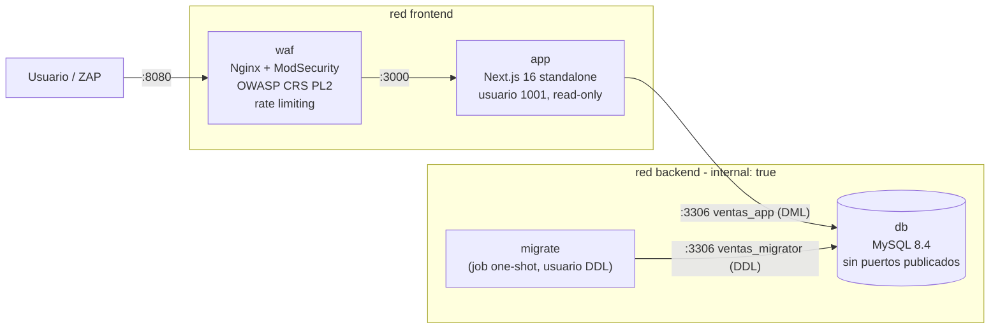

# DevSecOps – Ciclo de Vida Continuo de Seguridad

Este documento describe cómo **Ventas Online Segura** integra controles de seguridad automatizados en cada fase del *Continuous Application Security Lifecycle* exigido por el proyecto, y cómo ejecutar cada herramienta localmente en Windows.

## 1. Mapa de fases del curso → controles implementados

| Fase del proyecto | Control | Herramienta | Dónde |
|---|---|---|---|
| **Fase 3** – Desarrollo seguro | SAST (OWASP Top 10, TypeScript, React, Next.js) | Semgrep + reglas propias | `.github/workflows/devsecops.yml` (job `sast`), `security/semgrep/reglas-ventas.yml` |
| Fase 3 | Detección de secretos en el repositorio | Gitleaks, `p/secrets` | job `secrets` |
| Fase 3 | SCA (CVE en dependencias) | `npm audit`, OSV-Scanner (gate real, excepciones en `osv-scanner.toml`) | job `sca` |
| Fase 3 | Integridad del lockfile | `lockfile-lint` (solo registro npm y HTTPS) | job `sca` |
| Fase 3 | Inventario de software (SBOM) | CycloneDX (dependencias npm) | artefacto `sbom` |
| Fase 5 | SBOM de la imagen (incluye paquetes del SO base) | Trivy CycloneDX | artefacto `sbom-imagen` |
| Fase 3 | Actualización continua de dependencias con periodo de espera de 7 días | Dependabot `cooldown` | `.github/dependabot.yml` |
| Fase 3 | Endurecimiento de npm (sin scripts de instalación, `engine-strict`) | `.npmrc` | raíz del repositorio |
| Fase 3 | Acciones de CI inmutables | Acciones fijadas por SHA de 40 caracteres; imágenes por `@sha256` | `.github/workflows/devsecops.yml` |
| **Fase 4** – Ciberdefensa | Pruebas E2E de seguridad (caja gris: login + 2FA, IDOR, control de acceso, CSRF, XSS, checkout, rate limit) | Playwright contra la app en modo producción + MySQL 8.4 de servicio (sin WAF, para que los límites por IP no interfieran) | job `e2e`, `e2e/` |
| Fase 4 | DAST caja negra (pasivo) | OWASP ZAP baseline | job `dast`, `security/zap/rules.tsv` |
| Fase 4 | DAST activo / autenticado (caja gris) | ZAP Desktop, Burp Suite | `security/zap/README.md` |
| **Fase 5** – Despliegue | Escaneo de imagen OCI (SO base + npm + secretos) | Trivy | job `container` |
| Fase 5 | Hardening de IaC | Checkov (Terraform, Dockerfile, Compose, GitHub Actions) | job `iac`, `infra/terraform/aws` |
| Fase 5 | Contenedor endurecido | Dockerfile multi-stage, no-root, read-only, `cap_drop: ALL` | `Dockerfile`, `docker-compose.yml` |
| **Fase 6** – Operación | WAF (OWASP CRS PL2 + reglas propias) | ModSecurity + Nginx (local), AWS WAFv2 (cloud) | `infra/waf/`, `infra/terraform/aws/waf.tf` |
| Fase 6 | Monitoreo / SIEM | Logs JSON + CloudWatch + alarmas | `infra/terraform/aws/cloudwatch.tf`, sección 4 |

### Política de *gates* (cuándo falla el pipeline)

| Gate | Criterio de bloqueo |
|---|---|
| SAST | Cualquier hallazgo `ERROR` de Semgrep |
| Secretos | Cualquier secreto detectado por Gitleaks |
| SCA | Vulnerabilidad **HIGH/CRITICAL** en dependencias de producción (`npm audit`); cualquier vulnerabilidad de OSV no aceptada en `osv-scanner.toml`; lockfile con hosts o protocolos no permitidos |
| IaC | Cualquier check de Checkov fallido sin `#checkov:skip` justificado |
| Contenedor | CVE **CRITICAL/HIGH** con parche disponible |
| E2E | Cualquier prueba de Playwright fallida |
| DAST | Alerta marcada como `FAIL` en `rules.tsv` |
| Todos | Tiempo máximo por job (`timeout-minutes`: 15, DAST 30) |

### Resumen de seguridad de cada ejecución

El último job, `resumen`, corre siempre, incluso cuando algún control falla. Escribe en la pestaña **Summary** del run una tabla con el estado y las cifras de los 8 controles: pruebas, hallazgos SAST, secretos, vulnerabilidades SCA y de contenedores por severidad, controles IaC, pruebas E2E y alertas DAST. Incluye también los criterios de bloqueo y los enlaces a la evidencia (SARIF y artefactos).

- **Cómo obtiene las cifras:** cada job las publica como *outputs* en un paso final con `if: always()`.
- **Seguridad del propio job:** el script `.github/scripts/resumen-seguridad.mjs` las recibe por variable de entorno (`toJSON(needs)`), nunca interpoladas en el código, para evitar inyección en el workflow.
- **Costo:** unos 10 segundos, porque no vuelve a analizar nada.

### Cadena de suministro del pipeline

- **Acciones fijadas por SHA**: cada `uses:` apunta a un commit de 40 caracteres con la versión en un comentario (`# v4.4.0`). Un tag se puede mover; un SHA no. Dependabot (`github-actions`) propone los nuevos SHA.
- **Imágenes por digest**: Gitleaks y OSV-Scanner se ejecutan con `imagen:versión@sha256:...`.
- **`.npmrc`**: `ignore-scripts=true` (ninguna dependencia ejecuta `postinstall`), `engine-strict=true`, `audit-level=high`. npm 11.7 no tiene `min-release-age`, por eso el periodo de espera se aplica en Dependabot (`cooldown: 7 días`, 14 para versiones mayores).
- **`lockfile-lint`**: verifica que todo paquete del `package-lock.json` venga de `registry.npmjs.org` por HTTPS (evita lockfiles manipulados que apunten a otro servidor).

### Límite de tasa en el borde

| Ruta | Método | Límite Nginx (local) | AWS WAF (nube) |
|---|---|---|---|
| `/api/auth/sign-in/email`, `/api/auth/two-factor/*` | todos | 5/min, ráfaga 3–5 | regla `RateLimitLogin` |
| `/login`, `/login/2fa`, `/registro`, `/recuperar`, `/restablecer` (Server Actions) | **solo POST** (GET no se limita: la clave del `map` queda vacía) | 10/min, ráfaga 5 | regla `RateLimitLogin` (método POST + regex de rutas) |
| resto | todos | 20/s, ráfaga 40 | reglas administradas |

Nginx **sobrescribe** `X-Real-IP` y `X-Forwarded-For` con `$remote_addr`, y la app solo confía en ellos con `TRUST_PROXY=true` (obligatorio en producción). Sin eso, todas las IP se verían iguales y un atacante podría bloquear el acceso de todos.

## 2. Arquitectura de contenedores (entorno local / CI)



```
             Internet / Host
                   │ 8080 (único puerto publicado)
          ┌────────▼────────┐
          │ waf (ModSecurity│  ← bloquea SQLi/XSS/escáneres, 429 en login
          │  + CRS + Nginx) │
          └────────┬────────┘   red "frontend"
          ┌────────▼────────┐
          │ app (Next.js)   │  ← CSP, Zod, Better Auth, RBAC, auditoría
          └────────┬────────┘   red "backend" (internal: sin salida)
          ┌────────▼────────┐
          │ db (MySQL 8.4)  │  ← usuarios con menor privilegio
          └─────────────────┘
```

Arranque:

```bash
cp .env.docker.example .env.docker      # completar con valores aleatorios
docker compose up -d db
docker compose --profile migrate run --rm migrate
docker compose up -d --build
curl http://localhost:8080/api/health          # liveness: el proceso responde
curl "http://localhost:8080/api/health?db=1"   # readiness: también responde la BD
```

## 3. Ejecutar las herramientas localmente en Windows (sin Docker)

> Requisitos: Python 3.12 (`pip`), Node 22. Ejecutar desde la raíz del proyecto.

| Herramienta | Instalación | Comando |
|---|---|---|
| **Semgrep** (SAST) | `pip install semgrep` (o WSL si falla en Windows nativo) | `semgrep scan --config p/owasp-top-ten --config p/typescript --config security/semgrep/ src/` |
| **npm audit** (SCA) | incluido en npm | `npm audit --omit=dev --omit=optional --audit-level=high` |
| **OSV-Scanner** (SCA) | binario `osv-scanner_windows_amd64.exe` de GitHub Releases | `osv-scanner scan source --lockfile package-lock.json` |
| **SBOM** | npx | `npx @cyclonedx/cyclonedx-npm --omit dev --output-file sbom.cdx.json` |
| **Gitleaks** (secretos) | `winget install gitleaks` o binario de Releases | `gitleaks detect --source . --redact -v` |
| **Checkov** (IaC) | `pip install checkov` | `checkov -d infra/terraform --compact` y `checkov -f Dockerfile` |
| **Trivy** (imagen / FS) | `winget install AquaSecurity.Trivy` | Sin Docker: `trivy fs --scanners vuln,secret,misconfig .` · Con imagen: `trivy image ventas-online-segura:local` |
| **OWASP ZAP** (DAST) | ZAP Desktop (Java 17+) | Ver `security/zap/README.md` |
| **Terraform** | `winget install Hashicorp.Terraform` | `terraform -chdir=infra/terraform/aws fmt -check` / `validate` |

Las salidas (HTML/JSON/SARIF) se guardan en `docs/evidencias/` como **anexos del informe** (capturas de escaneos y reportes de herramientas).

## 4. Monitoreo, SIEM y respuesta (Fase 6)

### 4.1 Flujo de logs

```
App (stdout JSON) ─┐
WAF ModSecurity   ─┤                     ┌─► Metric filters + Alarmas ─► SNS (correo / on-call)
ALB access logs   ─┼─► CloudWatch Logs ──┤
VPC Flow Logs     ─┤   (KMS, 365 días)   └─► Subscription filter ─► OpenSearch / Wazuh (SIEM)
RDS audit/error   ─┘
```

- La aplicación escribe **una línea JSON por evento** en stdout; los eventos de seguridad llevan `"type":"audit"`, p. ej.:

```json
{"time":"2026-11-16T22:14:03.120Z","level":"warn","type":"audit","event":"auth.login.failed","ip":"203.0.113.7","userAgent":"Mozilla/5.0","email_hash":"9f2c…","reason":"invalid_password"}
```

- Datos personales (email, DPI, teléfono) **no** se escriben en claro: se usa hash HMAC o se omiten.
- En AWS, ECS envía stdout a `/ecs/<proyecto>/app`; WAF a `aws-waf-logs-*`; Flow Logs a `/aws/vpc/...`.
- Opcional: un *subscription filter* reenvía a **Amazon OpenSearch** o a un agente **Wazuh** (open source) para correlación.

### 4.2 Eventos de auditoría esperados

| Evento | Significado |
|---|---|
| `auth.login.success` / `auth.login.failed` | Inicio de sesión |
| `auth.register` / `auth.email.verified` | Alta de cliente |
| `auth.password.reset_requested` / `auth.password.reset` | Recuperación de contraseña |
| `auth.2fa.enabled` / `auth.2fa.failed` | Segundo factor del administrador |
| `authz.denied` | Acceso denegado (IDOR/BOLA, rol insuficiente) |
| `admin.product.create/update/delete`, `admin.category.*`, `admin.config.update` | Acciones administrativas |
| `order.created`, `payment.captured`, `payment.amount_mismatch` | Flujo de compra |
| `upload.rejected` | Archivo rechazado (tipo/tamaño) |

### 4.3 Consultas de detección (CloudWatch Logs Insights)

**Fuerza bruta / credential stuffing** – más de 10 fallos por IP en 5 minutos:

```sql
fields @timestamp, ip, email_hash
| filter type = "audit" and event = "auth.login.failed"
| stats count(*) as fallos, count_distinct(email_hash) as cuentas by ip, bin(5m)
| filter fallos > 10
| sort fallos desc
```
*(Muchas cuentas distintas desde una IP = credential stuffing; muchas IPs contra una cuenta = ataque distribuido.)*

**Acciones administrativas fuera de horario** (antes de 07:00 o después de 20:00, hora Guatemala UTC-6):

```sql
fields @timestamp, event, actor, ip, time
| filter type = "audit" and event like /^admin\./
| parse time "*T*:*" as dia, horaUtc, resto
# 20:00–07:00 en Guatemala (UTC-6) = 02:00–12:59 UTC
| filter horaUtc in ["02","03","04","05","06","07","08","09","10","11","12"]
| sort @timestamp desc
```

**Enumeración de pedidos (IDOR)**:

```sql
fields @timestamp, ip, actor, resource
| filter type = "audit" and event = "authz.denied"
| stats count(*) as intentos by actor, ip, bin(10m)
| filter intentos > 5
```

**Pico de bloqueos del WAF** (log group `aws-waf-logs-*`):

```sql
fields @timestamp, httpRequest.clientIp as ip, terminatingRuleId, httpRequest.uri as uri
| filter action = "BLOCK"
| stats count(*) as bloqueos by ip, terminatingRuleId, bin(5m)
| sort bloqueos desc
| limit 50
```

**Manipulación de pagos**:

```sql
fields @timestamp, actor, orderId, expected, received
| filter type = "audit" and event = "payment.amount_mismatch"
```

### 4.4 Regla equivalente en Wazuh (ejemplo)

```xml
<group name="ventas,authentication_failures,">
  <rule id="100100" level="5">
    <decoded_as>json</decoded_as>
    <field name="type">audit</field>
    <field name="event">auth.login.failed</field>
    <description>Ventas: inicio de sesión fallido</description>
  </rule>
  <rule id="100101" level="10" frequency="10" timeframe="300">
    <if_matched_sid>100100</if_matched_sid>
    <same_field>ip</same_field>
    <description>Ventas: posible fuerza bruta desde la misma IP</description>
    <mitre><id>T1110</id></mitre>
  </rule>
</group>
```

### 4.5 Respuesta a incidentes (resumen)

1. **Detección**: alarma SNS (fuerza bruta, IDOR, manipulación de pago, pico WAF, 5xx).
2. **Contención**: bloquear IP en el IP set del WAF / revocar sesiones del usuario afectado (Better Auth `revokeSessions`) / rotar secretos en Secrets Manager.
3. **Erradicación y recuperación**: parche + redeploy vía pipeline (los gates impiden reintroducir la falla); restauración desde snapshot RDS si hubo alteración de datos.
4. **Lecciones aprendidas**: nueva regla Semgrep/WAF y caso de prueba que reproduzca el ataque.

## Anexo: job `e2e` (pruebas de seguridad de punta a punta)

| Paso | Qué hace |
|---|---|
| Servicio `mysql:8.4@sha256:…` | Base de datos efímera solo para el runner |
| Usuarios de BD | Crea `ventas_app` (solo DML) y `ventas_migrator` (DDL) con los mismos permisos que `infra/db/init/01-usuarios.sh`; contraseñas aleatorias enmascaradas en el log |
| `.env.local` efímero | Secretos aleatorios (`openssl rand`), `PAYMENT_MODE=simulado`, `TRUST_PROXY=true`, `MAIL_CAPTURE_DIR` (buzón de archivos en lugar de SMTP) |
| Migraciones y semilla | `npm run db:migrate:local` y `npm run db:seed` |
| App | `npm run build` y `next start` con `NODE_ENV=production`; espera a `/api/health?db=1` |
| Pruebas | `npm run test:e2e` con `E2E_CREAR_ADMIN=1` (crea el administrador de prueba) |
| Evidencia | Artefactos `playwright-report/` y `test-results/` (capturas y trazas para los anexos del informe) |

Se ejecuta sin el WAF a propósito: la suite hace muchos inicios de sesión desde una misma IP y los límites de tasa del borde (correctos en producción) la bloquearían. El WAF se valida aparte en el job `dast`.
